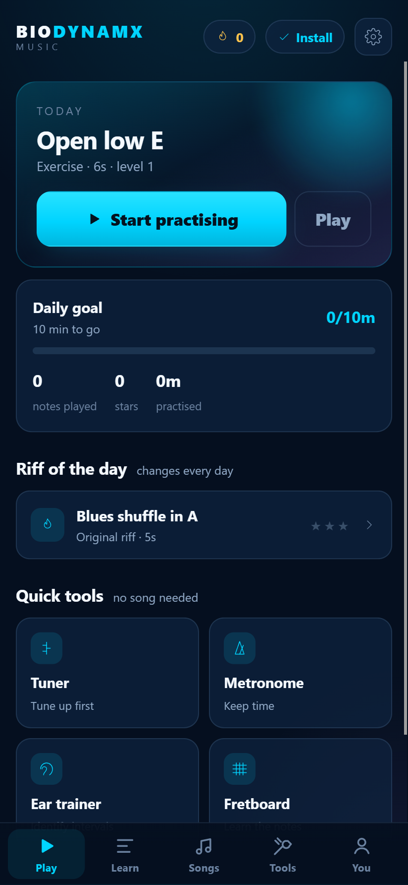

# Bio Dynamx Music

Guitar practice that starts the second you open it.

No account. No subscription. No trial timer. You open the app, it listens through
your microphone, and it tells you which notes you actually played and how well
you kept time.

Built for Android and Apple devices as an installable web app (PWA), with a
Capacitor shell in [`native/`](native/) if you want a real `.apk` / `.ipa`.



---

## Start it

```powershell
node tools/serve.mjs
```

Open <http://127.0.0.1:5173>, tap **Start practising**, allow the microphone.
That is the whole setup. Nothing to install, no build step, no dependencies.

Requirements: Node 18+ for the dev server only. The app itself is plain
ES-module JavaScript with zero npm dependencies.

---

## Put it on a phone

Microphones require a **secure context**, so the app has to be served over HTTPS
(or `localhost`) — that is a browser rule, not a limit of the app.

```powershell
npx netlify deploy --dir=www --prod     # or any static host, or Cloudflare Pages
```

- **Android / Chrome:** open the URL → tap **Install** in the header.
- **iPhone / Safari:** open the URL → **Share** → **Add to Home Screen**.

Full-screen, offline-capable, and the icon sits next to your other apps.
For a native shell, see [`native/README.md`](native/README.md).

---

## What is in it

**Practice that waits for you.** In Practice mode the song stops at the next note
until you play it, so a beginner is never left behind. Play mode runs at full
tempo and is what earns stars.

**Real note detection, not a tap-along.** The app listens to the microphone,
estimates the fundamental with YIN, then refines it against the partial series so
that string inharmonicity does not skew the reading. Measured accuracy on the
synthetic test bench: **±0.03 cents** across the neck at 44.1 and 48 kHz.

**A six-lane note highway** built from real tablature: low E nearest you, fret
numbers on the notes, chord blocks with strum direction, bar numbers down the
side, and a live read-out of what the app is hearing.

**Ten levels, 35 pieces.** Open strings → first melodies → cowboy chords →
the four-chord loop → riffs → lead → barre → fingerstyle → groove → full pieces.
Nothing is locked; skip ahead whenever you like.

**12 songs and 23 drills.** All public domain (Twinkle, Ode to Joy, Greensleeves,
Scarborough Fair, Amazing Grace, House of the Rising Sun, Für Elise, Minuet in G)
or written for this app. No licensed material, nothing to take down.

**A band that costs nothing.** Kick, snare, hats, bass and click are synthesised
at runtime from oscillators and a noise buffer. No audio files, so the whole app
is a few hundred kilobytes and works with the phone in aeroplane mode.

**Tools that stand alone:** chromatic tuner with 8 tunings and reference tones,
metronome 20–240 BPM, ear trainer, fretboard quiz, scale checker, latency
calibration.

**Progress that stays put.** Stars, streaks and totals live in `localStorage`.
Export them to a JSON file and import on another device; there is no server to
lose them on.

---

## How the reverse engineering fed into this

Yousician's practice engine is not shipped on the web — `yousician.com/app`,
`/login` and `/tuner` all 404, and the site is a Next.js marketing funnel. Their
sister product **GuitarTuna does ship a real-time pitch engine as WebAssembly**,
and that is what was actually analysed: an Emscripten/embind build of a C++
`Yousician::Ooura_FFT` engine exposing `analyseBuffer()` and returning
`MeasuredPitchHz`, `TuningErrorCents` and `CanHearANote`.

The findings — evidence IDs, digests, what was observed versus what is
documentation versus what is this project's own design decision — are written up
in **[docs/REA-FINDINGS.md](docs/REA-FINDINGS.md)**, with the raw REA bundles in
[`docs/evidence/`](docs/evidence/).

Short version of the design consequence: the *experience* is modelled on the
documented behaviour (one silver → three gold stars per part, a 3×→5× multiplier,
a 10-level path, wait-to-play practice, tablature with strum arrows), while the
engine, the note highway geometry and the judgment windows are original work.

---

## Verification

```powershell
node tools/pitch-test.mjs      # pitch engine against synthesised strings
node tools/content-test.mjs    # every piece builds, is in range, is playable
node tools/serve.mjs           # then run the browser tests below
```

The pitch bench checks all six open strings, 40 fretted notes, a ±40 cent detune
sweep, silence/noise rejection and chord chroma, at 44.1 and 48 kHz.

The gameplay path was verified end-to-end in a real browser using Chrome's fake
audio device fed with a synthesised low-E loop
(`tools/make_test_audio.py` → `tools/fixtures/lowE-loop.wav`): the microphone
opened, the count-in ran, all 8 notes were judged Perfect, and the run scored
100,000 with three stars.

---

## Layout

```
www/                 the entire app — this folder is the deliverable
  index.html
  js/audio/pitch.js      YIN + inharmonicity-aware spectral refinement
  js/audio/engine.js     microphone capture (ScriptProcessor, iOS-safe)
  js/audio/band.js       synthesised drums, bass, metronome, reference tones
  js/game/session.js     playhead, wait-mode clamping, judging
  js/ui/highway.js       canvas note highway
  js/music/scoring.js    windows, multiplier, stars, score
  js/content/library.js  35 pieces + the 10-level path
tools/               dev server, test benches, icon/audio generators
native/              Capacitor shell + instructions for APK/IPA
docs/                reverse-engineering report, product brief, evidence
```

No bundler, no framework, no `node_modules`. Open `www/index.html` and read it.

---

## Limits worth knowing

- **Microphone quality decides everything.** Built-in laptop mics are fine for
  single notes; chords need you reasonably close and a quiet room. Wired
  headphones help a lot; Bluetooth adds latency.
- **Chords are graded by pitch-class coverage**, not by full polyphonic
  transcription. A cleanly strummed cowboy chord is judged reliably; a
  five-string barre with a dead note may still pass.
- **Native builds are not produced here.** No Android SDK or macOS was available
  on the build machine, so `native/` is a verified scaffold with exact steps
  rather than a signed binary. The PWA path is fully working.
- **Two players, no accounts.** If you want separate progress per person, use
  separate browser profiles or the export/import buttons.

---

## Licence and credits

App code, drills, exercises and original pieces: written for this project.
Traditional melodies are public domain. Brand colours follow the BioDynamX
identity (deep navy `#0B1D3A`, electric cyan `#00D4FF`).

Not affiliated with Yousician Oy. GuitarTuna and Yousician are their trademarks;
no code or content from either is included in this repository.
